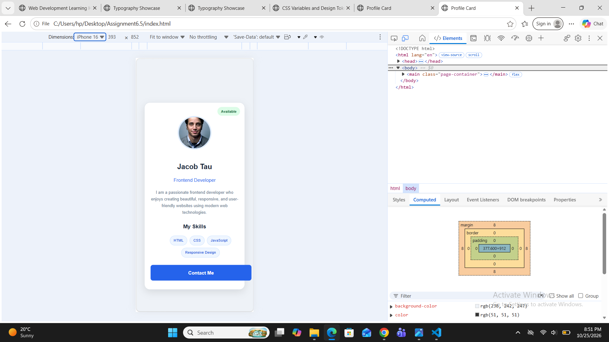

# Assignment 6.5 — Profile Card / Product Card Mini-Project

## Theory

### Aim

To design and develop a responsive profile card or product card using HTML and CSS, applying the CSS box model, background colors, borders, border radius, positioning, and meaningful CSS class names.

### Introduction

A card is a reusable UI component used to display information in a structured and visually appealing format. A profile card presents information about a person, such as their name, role, skills, and contact details. A product card displays product information, including its image, name, price, description, and purchase button.

HTML is used to structure the card content, while CSS is used to style and position its elements. Responsive design techniques ensure that the card displays correctly on different screen sizes.

### Concepts Used

1. HTML Structure: HTML elements are used to organize the card's content, including images, headings, descriptions, skills, prices, and buttons.

2. CSS Box Model: The box model consists of content, padding, border, and margin. It helps control the size and spacing of the card and its elements.

3. Background and Borders: The `background-color` property adds background colors, while the `border` property defines the outline of the card.

4. Border Radius: The `border-radius` property creates rounded corners, giving the card a modern appearance.

5. CSS Positioning: The `position` property is used to place a badge or button at a specific location within the card.

6. Meaningful CSS Class Names: Descriptive class names make the stylesheet easier to understand, organize, and maintain.

7. Responsive Design: CSS media queries and flexible dimensions help the card adapt to different screen widths, including mobile phones, tablets, and desktops.

8. Buttons and Interaction: A contact or buy button allows users to perform an action, such as contacting a person or proceeding to purchase a product.

### Working of the Project

The card displays information in a compact and organized layout. A profile card includes a profile image, name, professional role, short description, skills, and a contact button. Alternatively, a product card includes a product image, name, price, description, and a buy button.

CSS properties are applied to improve the card's appearance through spacing, colors, borders, rounded corners, and positioning. Responsive styling ensures that the component remains readable and visually balanced across different devices.

### Advantages

- Presents information in a clear and organized format.
- Improves the visual appearance of a webpage.
- Encourages reusable and maintainable code.
- Supports responsive layouts for different devices.
- Provides a foundation for building modern user interfaces.

### Conclusion

This assignment demonstrates how HTML and CSS can be used to create a complete and responsive profile card or product card component. By applying the CSS box model, styling properties, positioning, and responsive design techniques, a visually appealing and reusable component can be developed for a website.
## Finished card component
.png>)
## Card on different screenwidth

